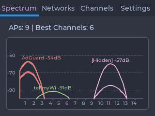
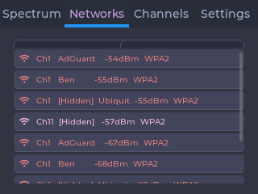
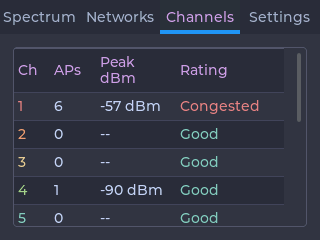
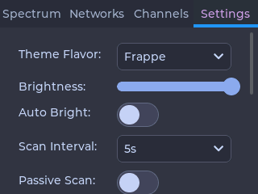
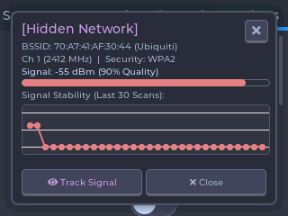
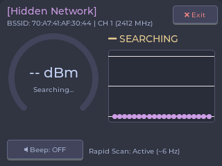

# :signal_strength: CYD WiFi Analyzer :pager:
[%3D'text'%5D%5Blast()%5D&label=Coveralls&style=for-the-badge&logo=coveralls)](https://coveralls.io/github/nicholaswilde/cyd-wifi-analyzer?branch=main)
[](https://taskfile.dev/#/)
[](https://github.com/nicholaswilde/cyd-wifi-analyzer/actions/workflows/test.yaml)
[](https://github.com/nicholaswilde/cyd-wifi-analyzer/actions/workflows/ci.yaml)

An interactive, touch-screen-enabled 2.4 GHz spectrum analyzer, access point catalog, and signal tracker designed for the **ESP32 Cheap Yellow Display (CYD)** hardware family. Powered by **LVGL v8** and styled with the **Catppuccin** color system.

> [!WARNING]
> This project is currently in an active `v0.X.X` development stage. Features, interfaces, and configurations are subject to continuous improvement.

---

## :star: Features

- **2.4 GHz Overlapping Parabolic Spectrum Visualizer**:
  - Replicates classic RF analyzer visuals with true mathematical parabolic channel response curves across channels 1–14 (22 MHz channel spread, spanning $\pm 2$ channels around the center frequency).
  - Individual Catppuccin color accents assigned to each channel.
  - Floating apex badges showing SSID and peak RSSI (dBm) for the strongest detected network per channel.
  - Live summary banner highlighting total APs and recommended clean / low-noise channels.

- **Access Point Catalog (Networks Tab)**:
  - Scrollable catalog showing all detected 2.4 GHz networks.
  - Displays SSID, BSSID (MAC Address), Channel, RSSI with visual signal bar, and Security/Auth type (Open, WEP, WPA, WPA2, WPA3).
  - Automatic detection and labeling of hidden networks (`[Hidden Network]`).

- **Network Detail Inspector Modal**:
  - Interactive popup modal triggered by tapping any network item in the catalog.
  - Comprehensive network telemetry: SSID, BSSID, Signal Quality (%) and RSSI (dBm), Channel and exact center frequency (e.g., Ch 6 $\rightarrow$ 2437 MHz), Auth Mode, and Hidden status.
  - 8-sample rolling historical RSSI line chart (`lv_chart`) for live signal fluctuation analysis.
  - Quick-launch button to enter dedicated **Tracker Mode**.

- **Target AP Signal Locator & Tracking Mode**:
  - Dedicated hunting/tracking mode focused on locating a specific Access Point.
  - High-cadence single-channel rapid scanning targeting exclusively the chosen AP's channel (~120ms dwell time vs. 5.6s across 14 channels, ~50ms re-scan interval $\rightarrow$ ~6 Hz update rate).
  - 270° radial arc signal meter gauge (`lv_arc`) with Catppuccin color styling.
  - Large real-time dBm readout and proximity descriptors (*Very Close / Immediate*, *Close Range (Strong)*, *Moderate Distance*, *Weak / Distant*, *Faint / Out of Range*).
  - Real-time 20-sample rolling RSSI history line chart with signal trend indicator (**WARMER** / **COLDER** / **STABLE**).
  - Audio/chirp feedback on CYD onboard speaker amplifier (GPIO 26) with pitch scaling from 400 Hz to 2500 Hz based on proximity/dBm, with an on-screen mute toggle.
  - Real-time physical RGB LED proximity feedback.
  - Clean exit button to return to the standard multi-tab spectrum analyzer.

- **Channel Interference Matrix & Rating Table (Channels Tab)**:
  - Full 14-channel matrix displaying AP density, peak dBm, and cumulative co-channel/adjacent channel interference noise scores.
  - Evaluates channel health into ratings: **Clean** (zero noise), **Good** ($\le 2$ APs), **Fair** (3–5 APs), or **Congested** ($> 5$ APs).
  - Real-time ranking of recommended clean channels in the 1–11 regulatory range.

- **Catppuccin RGB565 Theming**:
  - Full runtime switching across 4 Catppuccin flavors: **Mocha**, **Macchiato**, **Frappé**, and **Latte**.
  - All tabs, widgets, modals, charts, and channel curves redraw seamlessly in the active palette.

- **Onboard Active-Low RGB Status LED**:
  - Physical visual feedback using the onboard RGB LED (GPIO 4/16/17 on 2.8", GPIO 4/17/16 on 3.5").
  - Status cues:
    - **Blue pulse/blink**: Wi-Fi channel scan currently in progress.
    - **Green solid**: Scan completed with low interference / clean recommended channels.
    - **Yellow/Red solid**: Moderate or heavy channel congestion / RF noise.
    - **Tracker mode**: Green when near, Yellow when moderate, Red when distant.
  - Settings controls to toggle the LED on/off and adjust LED brightness with gamma 2.2 scaling.

- **MicroSD Card Screenshot Capture & Physical BOOT Button**:
  - **Long Press ($\ge 2$s)**: Captures the active LVGL display buffer directly to a 24-bit BMP image on an inserted FAT32 microSD card (e.g. `/screenshot_YYYYMMDD_HHMMSS.bmp`) using zero large-memory tile streaming to prevent heap fragmentation.
  - **Quick Press ($< 1$s)**: Triggers an immediate Wi-Fi spectrum rescan.
  - **On-Screen & LED Cues**: Shows a clean Catppuccin toast card (`Screenshot saved!` / `SD Card Missing!`) and triggers status LED pulse feedback.

- **LDR Ambient Light Auto-Dimming**:
  - Automatic backlight brightness adjustment driven by the onboard LDR photoresistor (GPIO 34).
  - Exponential Moving Average (EMA) light filtering with natural $\gamma = 2.2$ gamma-corrected PWM fading via `BacklightManager`.

- **Persistent Configuration via NVS (SettingsManager)**:
  - Backed by ESP32 `Preferences` non-volatile storage.
  - Remembers theme flavor, backlight brightness, auto-dimming toggle, scan interval, passive/active scan mode, screen orientation, and status LED settings across reboots.
  - One-touch factory defaults restoration button.

---

## :hammer_and_wrench: Hardware Requirements

- **ESP32 Cheap Yellow Display (CYD)**:
  - **CYD 2.8" (Resistive)**: `ESP32-2432S028R` — 2.8″ 320×240 ILI9341 LCD with XPT2046 resistive touch (`cyd_28r` / `cyd_28r_inv`).
  - **CYD 2.8" (Capacitive)**: `ESP32-JC2432W328C` — 2.8″ 320×240 ST7789 LCD with CST816 capacitive touch (`cyd_28c` / `cyd_28c_inv`).
  - **CYD 2.8" NodeMiner / Rockbase (Resistive)**: `ESP32-2432S028` ("NM") — 2.8″ 320×240 ST7789 LCD with XPT2046 resistive touch (`cyd_28_nm` / `cyd_28_nm_inv`).
  - **CYD 3.5" (Capacitive)**: `ESP32-3248S035C` — 3.5″ 480×320 ST7796 LCD with GT911/CST820 capacitive touch (`cyd_35c` / `cyd_35c_inv`).
  - See [docs/hardware-variants.md](docs/hardware-variants.md) for detailed controller variations, noise band fixes, and build configurations.
- **Onboard Peripherals**:
  - **MicroSD Card Slot**: Standard FAT32 SPI interface (VSPI: CS=GPIO 5, SCK=GPIO 18, MISO=GPIO 19, MOSI=GPIO 23).
  - **BOOT Button**: Tactile user push button on GPIO 0.
  - **RGB Status LED**: Active-low LED on GPIO 4 (Red), 16 (Green), 17 (Blue) on 2.8" boards; GPIO 4 (Red), 17 (Green), 16 (Blue) on 3.5" boards.
  - **Ambient Light Sensor (LDR)**: Photoresistor on GPIO 34.
  - **Backlight Control**: PWM on GPIO 21 (or GPIO 27 on capacitive boards).
  - **Speaker / Buzzer**: Hardwired to GPIO 26 (`DAC_CHANNEL_2`).
- **Power & Programming**: Micro-USB or USB-C cable capable of supplying $\ge 500\text{ mA}$.

---

## :camera: Screenshots

### Device UI Showcase

| Screen | Landscape (320x240) |
|---|---|
| **2.4 GHz Spectrum View** |  |
| **Access Point Catalog** |  |
| **Channel Rating Table** |  |
| **System Settings** |  |
| **Network Detail Inspector** |  |
| **Target AP Signal Tracker** |  |

The device supports capturing the current screen as a standard 24-bit BMP image via two methods:
- **Physical BOOT button**: Press and hold the **BOOT button** (GPIO 0) on the CYD board for 2 seconds to save a timestamped BMP directly to an inserted FAT32 microSD card (e.g. `/screenshot_YYYYMMDD_HHMMSS.bmp`). A single quick press of the BOOT button triggers an immediate Wi-Fi rescan.
- **USB Serial Screenshot Tool**: Capture real-time screenshots directly over the USB serial connection using the `task screenshot` command.

---

## :rocket: Getting Started

### 1. Quick Install (Pre-compiled Binaries)

Flash pre-compiled firmware directly from your terminal using the flash script. Replace `/dev/ttyUSB0` with your actual serial port. By default, it flashes the `cyd_28r` version, but you can specify the target device as the first argument:

```bash
# Flash the default cyd_28r (2.8" resistive ILI9341 320x240 screen)
bash -c "$(curl -fsSL https://raw.githubusercontent.com/nicholaswilde/cyd-wifi-analyzer/main/scripts/flash.sh)" _ cyd_28r /dev/ttyUSB0

# Or flash the cyd_28c version (2.8" capacitive ST7789 320x240 screen)
bash -c "$(curl -fsSL https://raw.githubusercontent.com/nicholaswilde/cyd-wifi-analyzer/main/scripts/flash.sh)" _ cyd_28c /dev/ttyUSB0

# Or flash the cyd_28_nm version (2.8" NodeMiner ST7789 320x240 screen)
bash -c "$(curl -fsSL https://raw.githubusercontent.com/nicholaswilde/cyd-wifi-analyzer/main/scripts/flash.sh)" _ cyd_28_nm /dev/ttyUSB0

# Or flash the cyd_35c version (3.5" capacitive ST7796 480x320 screen)
bash -c "$(curl -fsSL https://raw.githubusercontent.com/nicholaswilde/cyd-wifi-analyzer/main/scripts/flash.sh)" _ cyd_35c /dev/ttyUSB0
```

> [!WARNING]
> Running a script directly from the internet with `bash -c "$(curl...)"` is a potential security risk. Always review the script's source code before executing it to ensure it is safe. You can view the script [here](https://github.com/nicholaswilde/cyd-wifi-analyzer/blob/main/scripts/flash.sh).

### 2. Build and Flash from Source

This project uses [PlatformIO](https://platformio.org/) and [Task](https://taskfile.dev/):

```bash
# Clone the repository
git clone https://github.com/nicholaswilde/cyd-wifi-analyzer.git
cd cyd-wifi-analyzer

# Initialize local environment (.env)
task init

# Build firmware for the configured board (defaults to cyd_28r via PIO_ENV in .env)
task build

# Or build explicitly for a specific board environment
task build:cyd_28r          # 2.8" Resistive Touch (ILI9341)
task build:cyd_28r_inv      # 2.8" Resistive Touch Inverted
task build:cyd_28c          # 2.8" Capacitive Touch (JC2432W328C)
task build:cyd_28c_inv      # 2.8" Capacitive Touch Inverted
task build:cyd_28_nm        # 2.8" Resistive Touch NodeMiner (ST7789)
task build:cyd_28_nm_inv    # 2.8" Resistive Touch NodeMiner Inverted
task build:cyd_35c          # 3.5" Capacitive Touch (ESP32-3248S035C)
task build:cyd_35c_inv      # 3.5" Capacitive Touch Inverted

# Upload firmware to your connected CYD board
task upload

# Open the serial monitor (115200 baud)
task monitor
```

### 3. Capture Real-Time Screenshots over USB Serial

Capture pixel-perfect screenshots of the display over the USB serial connection at any time—even while active 2.4 GHz channel scanning is in progress:

```bash
# Capture the currently displayed screen
task screenshot

# Or switch to a specific tab before capturing (0=Spectrum, 1=Networks, 2=Channels, 3=Settings)
task screenshot -- -t 0

# Or capture all 4 application screens automatically in sequence
task screenshot -- --all
```

Captured images are saved in `screenshots/` with a timestamped filename (e.g. `screenshots/screenshot_YYYYMMDD_HHMMSS.png`) and automatically update `screenshots/latest.png` for rapid inspection.

### 4. Run Host-Native Unit Tests & Coverage

Unit tests execute natively on host systems (Linux/macOS) with mocked hardware interfaces:

```bash
# Run all host-native unit tests
task test

# Generate and display terminal code coverage report
task coverage:report

# Upload coverage to Coveralls.io (requires COVERALLS_REPO_TOKEN in .env)
task coverage:upload
```

---

## :gear: Settings Tab Reference

The **Settings Tab** on the device provides touch controls for all runtime parameters:

| Setting | Control | Options / Range | Default | Description |
|---|---|---|---|---|
| **Theme Flavor** | Dropdown | `Mocha`, `Macchiato`, `Frappe`, `Latte` | `Mocha` | Changes the active Catppuccin color palette across the entire UI. |
| **Brightness** | Slider | `10%` to `100%` | `100%` | Sets manual TFT display backlight brightness with gamma 2.2 correction. |
| **Auto Bright** | Toggle Switch | `ON` / `OFF` | `OFF` | Enables dynamic ambient light backlight adaptation via the onboard LDR sensor. |
| **Scan Interval** | Dropdown | `1s`, `2s`, `3s`, `5s` | `3s` | Sets the idle delay between full 14-channel spectrum scan sweeps. |
| **Passive Scan** | Toggle Switch | `ON` / `OFF` | `OFF` | Toggles between active probe scanning and passive listening. |
| **Orientation** | Dropdown | `Landscape (0°)`, `Landscape (180°)` | `Landscape (0°)` | Rotates screen orientation by 180° for upside-down mounting. |
| **Status LED** | Toggle Switch | `ON` / `OFF` | `ON` | Enables or disables physical RGB status LED indications. |
| **LED Brightness** | Slider | `10` to `255` | `255` | Sets the maximum brightness of the RGB status LED. |
| **Reset Defaults** | Push Button | Tap to execute | — | Clears NVS preferences and restores safe factory configuration. |

---

## :computer: Development

This project is built with **PlatformIO** and supports ESP32 hardware compilation, static code analysis, and native desktop mock testing via a Unity test suite.

### Command Reference

| Action | Task Command | PlatformIO / CLI Equivalent | Description |
| :--- | :--- | :--- | :--- |
| **Initialize** | `task init` | `cp .env.example .env` | Initializes local environment file from template. |
| **Build** | `task build` | `pio run -e $PIO_ENV` | Compiles firmware for configured `PIO_ENV`. |
| **Upload** | `task upload` | `pio run -e $PIO_ENV --target upload` | Flashes firmware to connected board. |
| **Monitor** | `task monitor` | `pio device monitor` | Opens serial monitor (115200 baud). |
| **Erase & Upload** | `task eau` | `pio run -e $PIO_ENV -t erase -t upload` | Erases flash and flashes firmware. |
| **Upload & Monitor** | `task uam` | `pio run -e $PIO_ENV -t upload -t monitor` | Flashes firmware and opens serial monitor. |
| **Screenshot** | `task screenshot` | `uv run python scripts/capture-serial-screenshot.py` | Captures display screenshot over serial. |
| **Unit Tests** | `task test` | `pio test -e native` | Runs host-native unit test suite. |
| **Coverage Report** | `task coverage:report` | `lcov --capture ...` | Displays terminal code coverage breakdown. |
| **Upload Coverage** | `task coverage:upload` | `coveralls report ...` | Uploads LCOV coverage to Coveralls.io. |
| **Static Analysis** | `task check` | `pio check -e $PIO_ENV` | Runs `cppcheck` static code analysis. |
| **Clean** | `task clean` | `pio run -t clean` | Cleans PlatformIO build artifacts. |

### Release Workflow

The project includes automated versioning and release packaging skills:
- **`./scripts/release.sh`**: Runs pre-release validations (`task check`, `task test`), bumps `version.txt`, tags release, and atomic pushes to remote to trigger GitHub Actions release builds.
- **`./scripts/release_summary.py`**: Retrieves git commit history, groups conventional commits (`Features`, `Bug Fixes`, `Improvements`, `Documentation`, `Special Thanks`), and updates existing GitHub draft releases in-place.

---

## :wrench: Troubleshooting

If you encounter issues with your display, touch, or software, review the solutions below or [create an issue](https://github.com/nicholaswilde/cyd-wifi-analyzer/issues) on GitHub.

### Inverted Colors
If colors appear inverted (e.g. dark themes like `Mocha` show bright white backgrounds), your display batch uses inverted panel logic. Flash the corresponding `_inv` environment:
- `cyd_28r_inv`, `cyd_28c_inv`, `cyd_28_nm_inv`, or `cyd_35c_inv`
- Or append `-D TFT_INVERSION_ON=1` to your build flags.

### Garbled or Scrambled Screen
If the UI is scrambled or distorted, ensure the firmware environment matches your board's display controller and resolution:
- **2.8" Resistive (ILI9341)**: `cyd_28r` / `cyd_28r_inv` (320x240 landscape)
- **2.8" Capacitive (JC2432W328C)**: `cyd_28c` / `cyd_28c_inv` (320x240 landscape)
- **2.8" NodeMiner / ST7789 (`ESP32-2432S028`)**: `cyd_28_nm` / `cyd_28_nm_inv` (320x240 landscape)
- **3.5" Capacitive (ST7796)**: `cyd_35c` / `cyd_35c_inv` (480x320 landscape)

### Partial Screen Rendering / 80px Noise Band
If the display renders across 240 columns and the remaining 80 columns show uninitialized static noise, your board uses an **ST7789** controller. Use the `cyd_28_nm` or `cyd_28_nm_inv` environments in `platformio.ini`. See the detailed guide in [docs/hardware-variants.md](docs/hardware-variants.md) for background and configurations.

### Flashing & Bootloader Mode
- If flashing manually via serial (`esptool.py`), the ESP32 might remain in bootloader mode after writing. Press the physical **RESET / EN** button (or power cycle) to boot into the application.
- Wiping flash via `pio run -t erase` will restore all NVS settings to factory defaults.

### Touch Accuracy (Resistive Screens)
The 2.8" resistive variant (`cyd_28r`) uses an XPT2046 resistive touch controller. Ensure touches are made firmly with a stylus or fingernail. Capacitive variants (`cyd_28c`, `cyd_35c`) use true capacitive touch and do not require pressure.

### Power Delivery & Stability
Wi-Fi scanning triggers high current bursts ($\sim 250\text{--}350\text{ mA}$) on the 2.4 GHz RF radio. Intermittent reboots or brownouts indicate inadequate power. Ensure you are using a quality USB power supply and cable capable of supplying steady current.

---

## :balance_scale: License

[Apache License 2.0](LICENSE)

## :writing_hand: Author

This project was created in 2026 by [Nicholas Wilde](https://github.com/nicholaswilde/).
